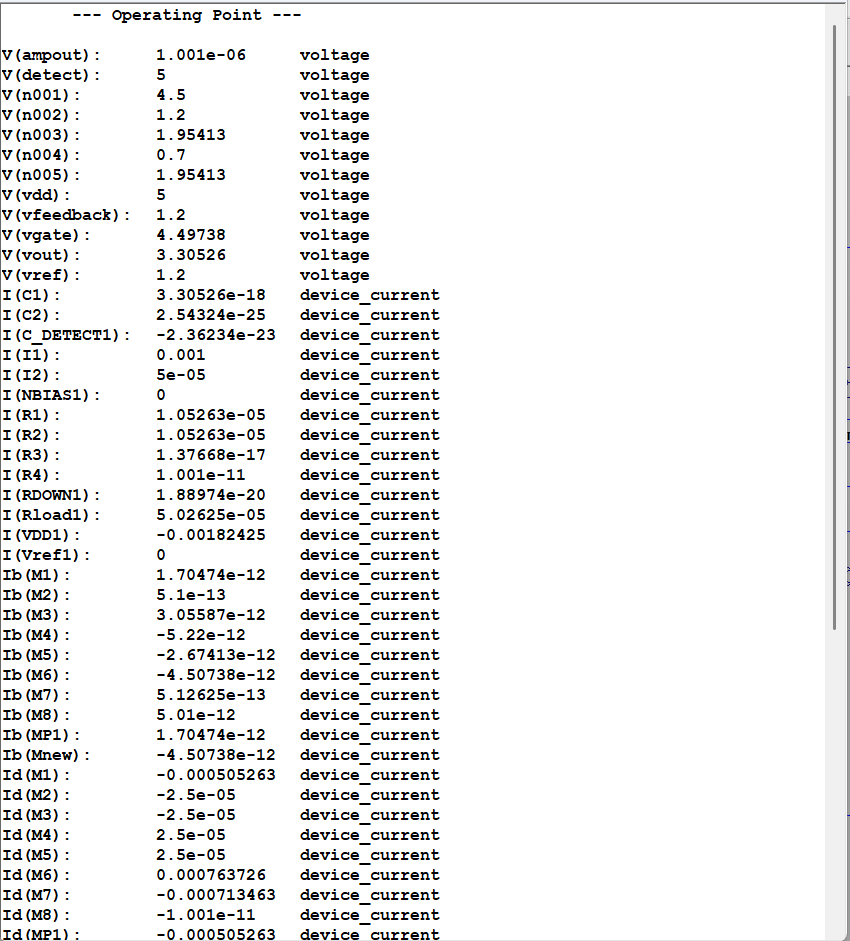

# CMOS LDO Voltage Regulator with Transistorized Adaptive Transient Boost

> Transistor-level CMOS LDO in LTspice: about 3.3 V regulated output from a 5 V supply, with a compact, fully transistorized adaptive transient detector that reduces output droop on a load step while drawing only picoamps when idle.

---

## Key Results

| Metric | Without Boost | With Adaptive Boost | Improvement |
|---|---|---|---|
| Output Voltage (DC, `.op`) | 3.305 V | 3.305 V | n/a |
| Peak Droop | 360 mV | 222 mV | **1.6x** |
| Recovery Time | ~12 µs | ~7 µs | **1.7x** |
| Boost-branch DC current | n/a | **~10 pA** (~50 pW at 5 V) | n/a |
| Load Step | 1 mA to 100 mA | 1 mA to 100 mA | n/a |
| Supply | 5 V | 5 V | n/a |

See [Measurement notes](#measurement-notes) for how the droop is defined and how to reproduce the exact figures.


---

## What This Project Shows

1. **Transistor-level error amplifier**: differential pair, mirror load, second stage and compensation network, built from individual MOSFETs. Ideal sources are used only for the 50 µA tail current, the 1.2 V second-stage bias and the 1.2 V reference.
2. **A fully transistorized adaptive detector**: no digital trigger and no ideal current source in the boost path. Two transistors (`M8`, `Mnew`) and three passives (`C_DETECT`, `RDOWN`, `R4`) detect a droop and switch the boost on.
3. **Negligible idle cost for the boost block**: at DC the boost branch carries about 10 pA (see the `.op` log in `results/`), so it is effectively off until a load transient occurs.

---

## Circuit Architecture

```
VDD (5V)
   |
[M1 || MP1: two PMOS pass devices in parallel, 200um/1um each]
   |
VOUT (3.305V) ------------------------------+
   |                                         |
[Two-Stage Error Amplifier]            [Output Network]
   |- NMOS diff pair (50uA tail)        C1 = 1uF
   |- PMOS mirror load                  I1 (pulse load)
   |- M6/M7 second stage                R1 = 200k
   '- R3/C2 compensation                R2 = 114k -> VFEEDBACK
   |
[VREF = 1.2V]

[Adaptive Boost Block]
   C_DETECT (47pF):  VOUT -> DETECT node
   RDOWN (47k):      DETECT -> VDD (pull-up)
   M8 (PMOS):        Gate=DETECT, Source=VDD, Drain=AMPOUT
   R4 (100k):        AMPOUT -> GND (pull-down)
   Mnew (NMOS):      Gate=AMPOUT, pulls the pass-device gate (VGATE) down
```


## How the Detector Works

**Steady state:**
```
DETECT = VDD  -> Vgs(M8) = 0 V -> M8 OFF
AMPOUT ~ 0 V (held low by R4) -> Mnew OFF
Boost branch carries ~10 pA
```

**During a load transient:**
```
VOUT droops -> C_DETECT couples the drop -> DETECT falls below VDD
Vgs(M8) goes negative -> M8 turns ON -> AMPOUT rises
Mnew turns ON -> pulls VGATE down -> pass devices turn ON harder
VOUT recovers faster
DETECT relaxes back to VDD through RDOWN -> boost turns OFF automatically
```

---

## Repository Structure

```
.
|-- ltspice/
|   |-- LDO_Final.asc           Baseline LDO (no boost), .tran 0 60u
|   |-- Transient_Boosted.asc   LDO with the adaptive boost block
|   '-- Booster_Circuit.asc     Standalone detector test (see below)
|
|-- results/
|   |-- schematic_full.png          Boosted LDO schematic
|   |-- boost_detector_schematic.png  Standalone detector schematic
|   |-- transient_baseline.png      Vout without boost
|   |-- transient_boosted.png       Vout with boost
|   |-- dc_operating_point_1.png    .op log, part 1
|   '-- dc_operating_point_2.png    .op log, part 2
|
|-- LICENSE
'-- README.md
```

`Booster_Circuit.asc` is a separate test bench for the detector alone: `VOUT` is an ideal pulse (3.3 V to 3.0 V), `RDOWN` is 10 kΩ returned to a 2.5 V bias, `C_DETECT` is 1 pF, the `AMPOUT` load is a diode-connected NMOS, and `MBOOST` is 500 µm/180 nm. Its values differ from the full LDO, so do not mix the two sets of numbers.

---

## Running the Simulations

### Requirements
- LTspice (free from Analog Devices)
- Windows or macOS

### Step 1: Verify DC operating point
1. Open `ltspice/Transient_Boosted.asc`
2. Comment out `.tran`, enable `.op`
3. Run, then `Ctrl+L` to view the log
4. Verify `V(vout) = 3.30526 V`

### Step 2: Baseline transient (no boost)
1. Open `ltspice/LDO_Final.asc`
2. Run `.tran 0 60u` and plot `V(vout)`

### Step 3: Transient with boost
1. Open `ltspice/Transient_Boosted.asc`
2. Run `.tran 0 60u` and plot `V(vout)`

The load is `PULSE(1m 100m 1u 1n 1n 5u 20u)`: 1 mA to 100 mA at 1 µs, held for 5 µs, period 20 µs.

---

## Measurement Notes

- **Droop** is measured as the pre-step output level minus the minimum of `V(vout)` during the load pulse.
- **The load pulse is only 5 µs wide.** In both plots the output minimum occurs at about 6 µs, exactly when the load is released, so the droop figure reflects how far `VOUT` falls in 5 µs rather than the loop's true worst case. A longer pulse (for example 30 µs) would show the full droop and recovery behaviour.
- The droop and recovery figures in the table are the originally reported values. Reading the saved screenshots gives roughly 345-360 mV (baseline) and 225-245 mV (boosted), depending on which pre-step level is used as the reference, so the improvement is about 1.5-1.6x. To pin the exact values down, add measurement directives to the schematic (untested here; node names may need adjusting):

```
.meas TRAN vpre   FIND V(vout) AT=0.9u
.meas TRAN vmin   MIN  V(vout) FROM=1u TO=6u
.meas TRAN droop  PARAM vpre-vmin
.meas TRAN trec   WHEN V(vout)=3.30 RISE=1 TD=6u
```

---

## Design Equations

**Output voltage:**
```
VOUT = VREF x (1 + R1/R2) = 1.2 x (1 + 200k/114k) = 3.305 V
```
The `.op` log reports `V(vout) = 3.30526 V`.

**First-stage transconductance** (assuming Kn = 120 µA/V², ID = 25 µA per side from the 50 µA tail):
```
Gm1 = sqrt(2 x Kn x W/L x ID) = sqrt(2 x 120u x 10 x 25u) ~ 245 uA/V
```

**Boost recovery time constant** (full LDO, `C_DETECT` = 47 pF, `RDOWN` = 47 kΩ):
```
tau = RDOWN x C_DETECT = 47k x 47p ~ 2.2 us
```

**Droop without boost:**
```
dV ~ dI x dt / C1
```
With dI = 99 mA and C1 = 1 µF, the simulated 360 mV droop corresponds to an effective dt of about 3.6 µs. That value is fitted to the simulation, not derived from the circuit.

---

## Transistor Specifications

Component names differ slightly between files (in `LDO_Final.asc` the NMOS pair is `M2`/`M3` and the PMOS mirror `M4`/`M5`; in `Transient_Boosted.asc` they are swapped). The table lists devices by function.

| Device | Type | W/L | Function |
|---|---|---|---|
| M1, MP1 | PMOS | 200µm/1µm each | Pass devices in parallel (same gate and drain nets) |
| Diff pair | NMOS | 10µm/1µm | Error amplifier input pair |
| Mirror load | PMOS | 10µm/1µm | Error amplifier load |
| M6 | NMOS | 20µm/1µm | Second stage driver |
| M7 | PMOS | 20µm/1µm | Second stage load |
| M8 | PMOS | 20µm/180nm | Transient detector |
| Mnew | NMOS | 100µm/1µm | Boost transistor |

The `.op` log shows `M1` and `MP1` each carrying 505 µA, which together equal the 1 mA load plus the 10.5 µA feedback divider current.



---

## Not Yet Characterised

These are the natural next simulations; none are in the repository yet:

- **Stability**: AC loop gain and phase margin, with and without the boost block (`.ac` on the feedback loop).
- **Quiescent current**: at the 1 mA operating point the supply provides about 1.82 mA (`I(VDD1)` in the `.op` log), and the second stage alone draws about 0.7 mA (`Id(M6)`, `Id(M7)`), so the regulator's own quiescent current is large compared with the load. Quiescent current versus load is worth plotting.
- **Regulation**: line regulation (`.step` on VDD), load regulation, and dropout voltage.
- **Corners**: temperature (`.step temp`) and MOSFET parameter variation. The models are generic Level-1, so results are indicative rather than process-accurate.
- **Longer load pulse**: see [Measurement notes](#measurement-notes).

---

## Related Work

Adaptive biasing and transient enhancement for low-quiescent-current LDOs are well established in the literature (references 1, 2 and 4 below). This project is a small, fully transistor-level implementation of that idea: an AC-coupled droop detector that drives a pull-down on the pass-device gate.

Building it exercises:
- MOSFET biasing and operating-region analysis
- Feedback loop design and compensation
- Transient response characterisation
- Performance versus quiescent-power trade-offs
- AC coupling for event detection

---

## References

1. P. Hazucha et al., "Area-Efficient Linear Regulator With Ultra-Fast Load Regulation," IEEE JSSC, 2005.
2. T. Y. Man et al., "A High Slew-Rate Push-Pull Output Amplifier for Low-Quiescent Current LDOs," IEEE TCAS-II, 2007.
3. K. N. Leung and P. K. T. Mok, "A Capacitor-Free CMOS Low-Dropout Regulator," IEEE JSSC, 2003.
4. M. Al-Shyoukh et al., "A Transient-Enhanced Low-Quiescent Current LDO," IEEE JSSC, 2007.
5. R. J. Milliken et al., "Full On-Chip CMOS Low-Dropout Voltage Regulator," IEEE TCAS-I, 2007.

---

## Author

**Aditya Dixit**, B.Tech Electronics & Communication Engineering
Simulated in LTspice using generic SPICE Level-1 MOSFET models, 2025
